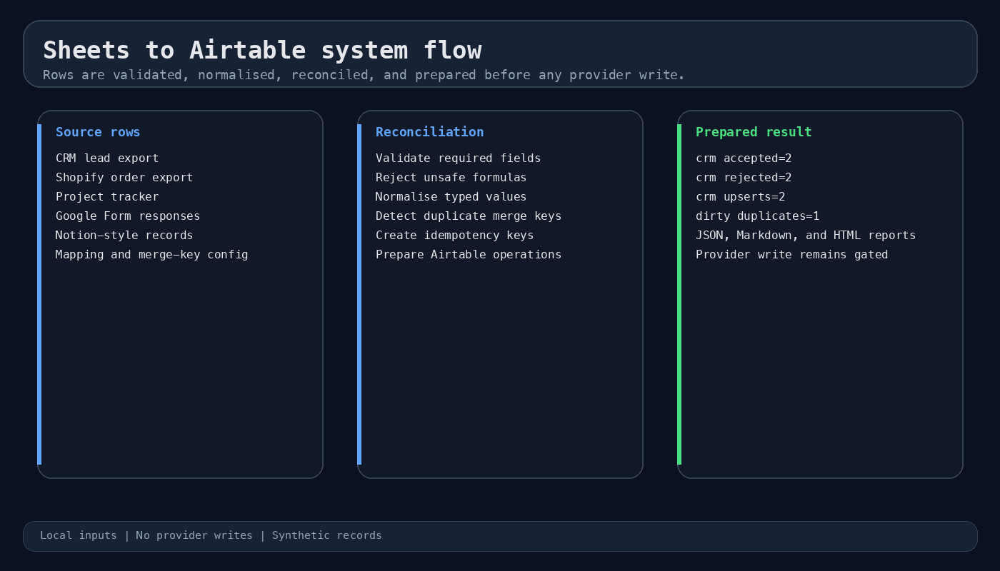
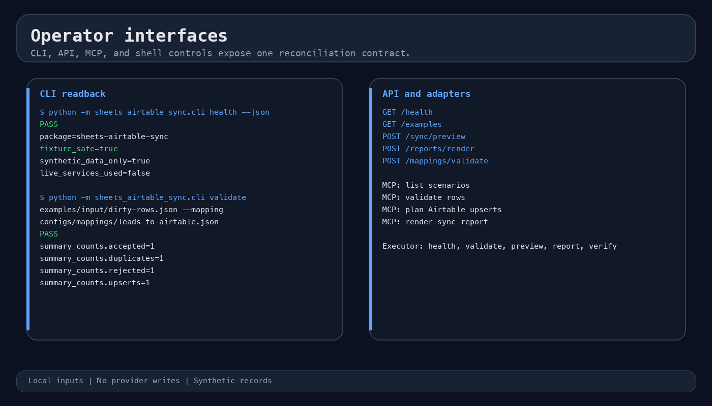
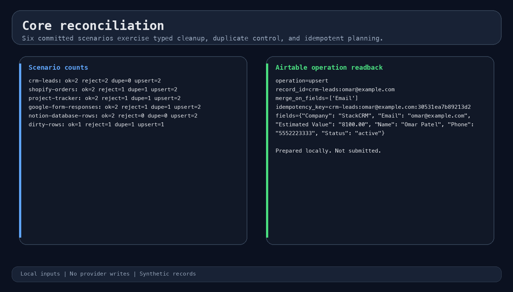
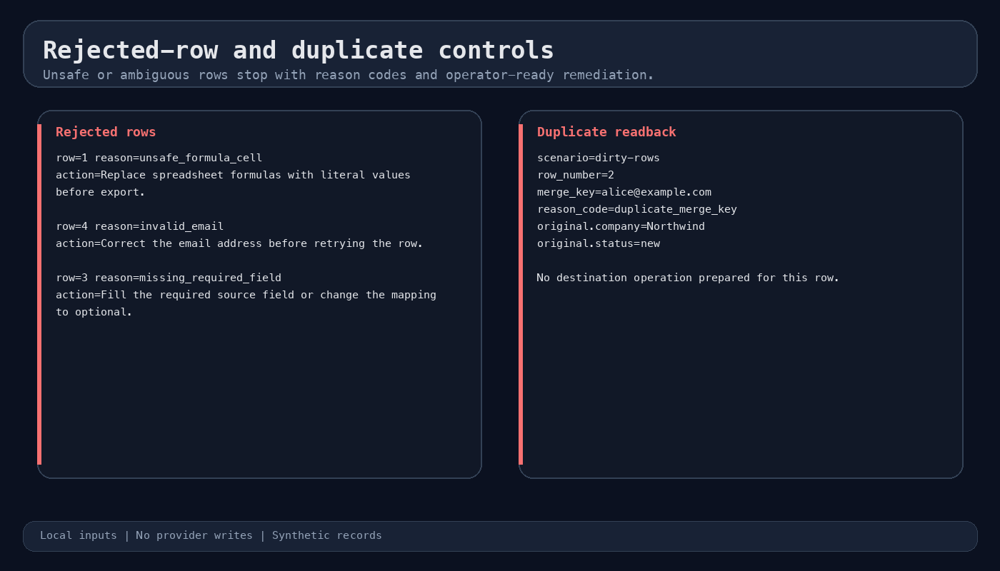
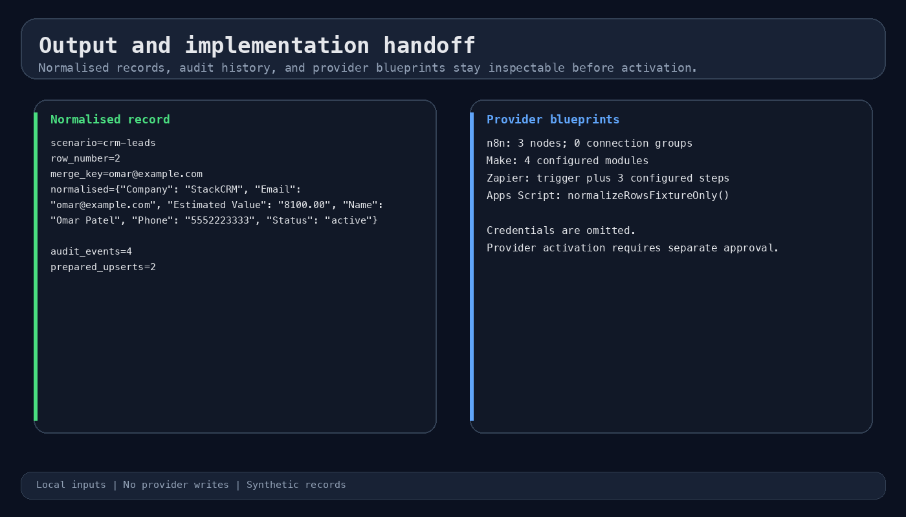
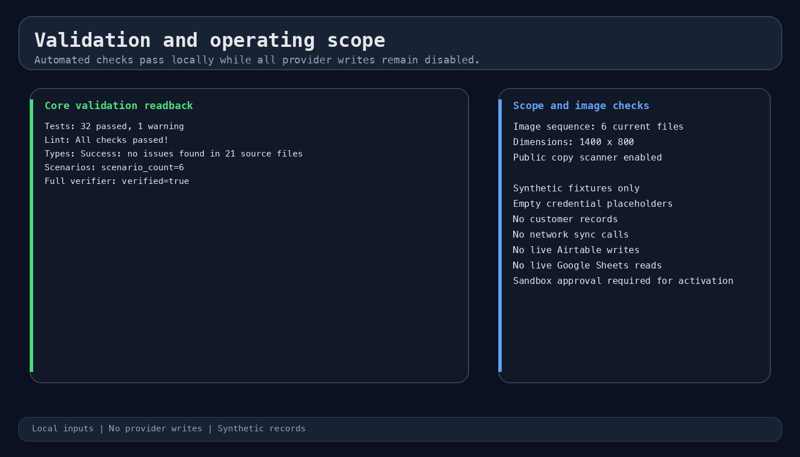

# Sheets Airtable Sync

Google Sheets to Airtable reconciliation service for validating, normalising, deduplicating, and planning record updates before a provider write.

[Case study](docs/case-study.md) | [Architecture](docs/architecture.md) | [Local operation](docs/local-operation.md)

## Overview

The service turns inconsistent spreadsheet rows into Airtable-ready upsert previews, rejected-row output, readable reports, and operator-accessible interfaces. It is designed for teams that need predictable data cleanup and a controlled handoff before changing a live base.

## Capabilities

- Config-driven field mapping and merge-key rules.
- Normalisation for email, status, date, currency, boolean, phone, and multi-select fields.
- Duplicate detection, reason-coded rejection handling, remediation notes, and idempotency keys.
- Buyer-shaped scenarios for CRM leads, Shopify orders, project trackers, Google Forms, and Notion-style rows.
- Airtable-shaped `performUpsert` previews without submitting provider writes.
- Make, Zapier, n8n, and Google Apps Script integration blueprints.

## Operating flow

1. Load a mapping and spreadsheet-shaped input.
2. Validate required fields and reject unsafe formula cells.
3. Normalise typed values and derive the merge key.
4. Separate duplicates and invalid rows with reason codes.
5. Prepare idempotent Airtable upsert operations.
6. Return JSON, Markdown, HTML, API, or MCP output for operator review.

## Interfaces

- **CLI:** health, validation, upsert planning, and report rendering.
- **FastAPI/OpenAPI:** local health, example discovery, sync preview, and report endpoints.
- **MCP:** agent-callable schema discovery and preview functions.
- **Executor:** stable shell contract for health, validation, preview, report, and verification.
- **Integration blueprints:** provider-specific handoff notes for n8n, Make, Zapier, and Apps Script.

## System views

### System flow



### Interface surface



### Core processing



### Guardrail and failure path



### Output and readback



### Validation and scope



## Run locally

```bash
python3.11 -m venv .venv
source .venv/bin/activate
pip install -e '.[dev]'
PYTHONPATH=src python -m sheets_airtable_sync.cli health --json
PYTHONPATH=src python -m sheets_airtable_sync.cli validate-examples
```

Start the local API:

```bash
PYTHONPATH=src python -m uvicorn sheets_airtable_sync.api:app --host 127.0.0.1 --port 8014
curl -fsS http://127.0.0.1:8014/health
curl -fsS -X POST http://127.0.0.1:8014/sync/preview \
  -H 'Content-Type: application/json' \
  --data @examples/api-requests/sync-preview-request.json
```

## Validation

```bash
PYTHONPATH=src python -m pytest -q
python -m ruff check .
PYTHONPATH=src python -m mypy src
python scripts/verify_examples.py
./executor.sh verify
PYTHONPATH=src python scripts/render_portfolio_images.py
```

## Scope boundaries

Committed scenarios use synthetic data and empty credential placeholders. No live Google Sheets, Airtable, CRM, Notion, Slack, Discord, Make, Zapier, n8n, cloud, payment, delivery, client-data, or external-submission action runs by default.

Live Google Sheets and Airtable operation requires separately approved credentials, target-schema confirmation, provider rate-limit handling, and a sandbox run. See [the live integration gate](docs/live-integration-gate.md).

## Project documentation

- [Validation record](docs/validation.md)
- [API contract](docs/api.md)
- [MCP contract](docs/mcp.md)
- [Executor contract](docs/executor.md)
- [Platform handoff](docs/platform-handoff.md)
- [Live integration gate](docs/live-integration-gate.md)

## License

MIT.
